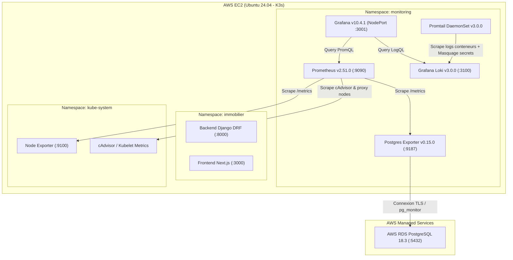
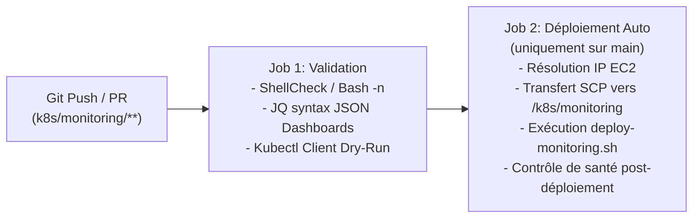

# Supervision DevOps - K3s, Prometheus, Loki, Grafana & AWS RDS PostgreSQL

Ce répertoire contient l'ensemble des configurations, manifestes Kubernetes, dashboards Grafana et scripts nécessaires à la supervision complète de la plateforme immobilière déployée sur AWS (EC2 Ubuntu avec K3s).

**GitHub constitue la source unique de référence (Single Source of Truth)** de toutes les configurations de supervision. Aucun secret en clair n'est stocké dans ce dépôt.

---

## 1. Architecture de Supervision



---

## 2. Structure des Fichiers

```text
k8s/monitoring/
├── 00-namespace.yaml                 # Création du namespace Kubernetes 'monitoring'
├── 01-rbac.yaml                      # ServiceAccounts et ClusterRoles pour Prometheus et Promtail
├── 02-prometheus.yaml                # Déploiement Prometheus, jobs de scrape et règles d'alerte
├── 03-loki.yaml                      # Déploiement Grafana Loki (moteur de logs, rétention 72h)
├── 04-promtail.yaml                  # DaemonSet Promtail (collecte CRI, labels namespace/pod/container/app)
├── 05-grafana-datasources.yaml       # Provisioning automatique des sources Prometheus et Loki
├── 06-grafana-dashboards.yaml        # ConfigMap Grafana contenant les 3 dashboards en production
├── 07-grafana.yaml                   # Déploiement Grafana et Service NodePort (:3001)
├── 08-rds-postgres-exporter.yaml     # Collecteur de métriques AWS RDS PostgreSQL (namespace monitoring)
├── 08-rds-postgres-secret.example.yaml # Modèle d'exemple pour le secret RDS (sans mot de passe)
├── 09-prometheus-rules.yaml          # Règles d'alertes (PostgreSQL, saturation CPU/RAM/disque, pods)
├── deploy-monitoring.sh              # Script automatisé de déploiement et de vérification
├── README.md                         # Documentation complète de supervision et maintenance
└── dashboards/                       # Fichiers sources JSON exportés (édition et import Grafana)
    ├── cluster-overview.json         # 1. Cluster K3s & Infrastructure - 
    ├── application-logs-metrics.json # 2. Application & Logs en Direct -
    └── aws-rds-postgresql.json       # 3. AWS RDS PostgreSQL Monitoring
```

---

## 3. Sécurité et Gestion des Identifiants

### Rôle PostgreSQL dédié avec privilèges stricts (`pg_monitor`)
Pour superviser AWS RDS PostgreSQL, un compte dédié `postgres_exporter` est utilisé :
- **Aucun privilège superutilisateur.**
- **Aucun accès aux tables applicatives** (garanti par PostgreSQL : `SELECT` sur `django_migrations` retourne `permission denied`).
- Attribution exclusive du rôle PostgreSQL standard `pg_monitor` pour lire les statistiques moteur (`pg_stat_database`, `pg_stat_activity`, `pg_settings`, verrous).

Commande de création sur RDS :
```sql
CREATE USER postgres_exporter WITH ENCRYPTED PASSWORD '<MOT_DE_PASSE_SECURISE>';
GRANT pg_monitor TO postgres_exporter;
GRANT CONNECT ON DATABASE postgres TO postgres_exporter;
```

### Secret Kubernetes sécurisé
Le secret contenant la chaîne de connexion est créé directement dans le namespace `monitoring` et n'est **jamais versionné dans Git** :
```bash
kubectl create secret generic rds-postgres-exporter-secret \
  -n monitoring \
  --from-literal=DATA_SOURCE_NAME="postgresql://postgres_exporter:<MOT_DE_PASSE>@gestion-immobilier.c7y6aigsos0d.eu-north-1.rds.amazonaws.com:5432/postgres?sslmode=require" \
  --from-literal=DB_USER="postgres_exporter" \
  --from-literal=DB_PASSWORD="<MOT_DE_PASSE>" \
  --from-literal=DB_HOST="gestion-immobilier.c7y6aigsos0d.eu-north-1.rds.amazonaws.com" \
  --from-literal=DB_PORT="5432" \
  --from-literal=DB_NAME="postgres"
```

### Protection des données sensibles dans les journaux
Le fichier [04-promtail.yaml](file:///C:/Users/didie/Desktop/Projet%20devops%20stage%20M2/k8s/monitoring/04-promtail.yaml) intègre un filtre de masquage regex :
- Tous les mots de passe, clés secrètes et jetons `Bearer` apparaissant dans les logs sont remplacés automatiquement par `[REDACTED]` avant d'être ingérés dans Loki.

---

## 4. Déploiement sur le Serveur EC2 / K3s

### Déploiement automatique
Exécuter le script de déploiement idempotent :
```bash
cd ~/k8s/monitoring
chmod +x deploy-monitoring.sh
./deploy-monitoring.sh
```

### Déploiement étape par étape (manuel)
```bash
# 1. Namespace & RBAC
kubectl apply -f 00-namespace.yaml
kubectl apply -f 01-rbac.yaml

# 2. Alertes & Prometheus
kubectl apply -f 09-prometheus-rules.yaml
kubectl apply -f 02-prometheus.yaml

# 3. Moteur de logs Loki & Promtail
kubectl apply -f 03-loki.yaml
kubectl apply -f 04-promtail.yaml

# 4. Supervision Base de Données AWS RDS
kubectl apply -f 08-rds-postgres-exporter.yaml

# 5. Visualisation Grafana
kubectl apply -f 05-grafana-datasources.yaml
kubectl apply -f 06-grafana-dashboards.yaml
kubectl apply -f 07-grafana.yaml
```

---

## 5. Validation et Tests de Fonctionnement

Exécutez les commandes suivantes pour certifier que tous les services sont sains :

```bash
# 1. Vérifier l'état de tous les pods du monitoring
kubectl get pods -n monitoring -o wide

# 2. Vérifier les endpoints et services
kubectl get svc -n monitoring

# 3. Vérifier que toutes les cibles Prometheus sont UP (y compris rds-postgres-exporter)
kubectl exec -n monitoring deploy/prometheus -- wget -qO- http://localhost:9090/api/v1/targets | jq '.data.activeTargets[] | {job: .labels.job, health: .health}'

# 4. Vérifier la présence des métriques pg_up et up
kubectl exec -n monitoring deploy/prometheus -- wget -qO- 'http://localhost:9090/api/v1/query?query=pg_up' | jq .
kubectl exec -n monitoring deploy/prometheus -- wget -qO- 'http://localhost:9090/api/v1/query?query=up{job="rds-postgres-exporter"}' | jq .

# 5. Vérifier que les labels Loki (namespace, container, pod, app) sont bien alimentés
kubectl exec -n monitoring deploy/loki -- wget -qO- 'http://localhost:3100/loki/api/v1/label/namespace/values' | jq .
kubectl exec -n monitoring deploy/loki -- wget -qO- 'http://localhost:3100/loki/api/v1/label/container/values' | jq .

# 6. Vérifier la prise en compte des règles d'alertes dans Prometheus
kubectl exec -n monitoring deploy/prometheus -- wget -qO- http://localhost:9090/api/v1/rules | jq '.data.groups[].name'
```

---

## 6. Tableaux de Bord Grafana

Les dashboards sont automatiquement chargés depuis `/var/lib/grafana/dashboards` dans le dossier **«Gestion-Immobilier »** :

| Dashboard | Description | Métriques / Requêtes clés |
| :--- | :--- | :--- |
| **1. Cluster K3s & Infrastructure** | Supervision matérielle et Kubernetes du nœud EC2 | `node_cpu_seconds_total`, `node_memory_MemAvailable_bytes`, `container_cpu_usage_seconds_total`, `container_memory_working_set_bytes` |
| **2. Application & Logs en Direct** | Suivi applicatif temps réel (Django DRF & Next.js) | `{namespace="immobilier", container="backend"}`, erreurs 4xx/5xx, détection d'exceptions, sonder `/api/health/` |
| **3. AWS RDS PostgreSQL Monitoring** | Supervision dédiée de l'instance PostgreSQL RDS | `pg_up`, `pg_stat_database_numbackends`, `pg_settings_max_connections`, transactions/s, cache hit ratio, deadlocks, taille de base |

---

## 7. Catalogue des Alertes Configurées

| Alerte | Condition PromQL | Durée | Sévérité | Description |
| :--- | :--- | :--- | :--- | :--- |
| `PostgresqlDown` | `pg_up == 0` | 1m | `critical` | Instance PostgreSQL RDS inaccessible. |
| `PostgresqlExporterDown` | `up{job="rds-postgres-exporter"} == 0` | 1m | `critical` | Collecteur RDS injoignable. |
| `PostgresqlHighConnectionUsage` | Connexions > 80% de `max_connections` | 3m | `warning` | Pool de connexions saturé. |
| `PostgresqlConnectionLimitExhaustion` | Connexions > 95% de `max_connections` | 1m | `critical` | Risque imminent de rejet de requêtes. |
| `PostgresqlRollbackRateHigh` | `rate(pg_stat_database_xact_rollback[5m]) > 2` | 2m | `warning` | Taux anormal d'erreurs/rollbacks SQL. |
| `PostgresqlDeadlocksDetected` | `increase(pg_stat_database_deadlocks[5m]) > 0` | 1m | `warning` | Interblocage de verrous détecté. |
| `PostgresqlLowCacheHitRatio` | Cache Hit Ratio < 85% | 5m | `warning` | Trop d'accès disques lents par rapport à la RAM. |
| `NodeCPUSaturation` | Utilisation CPU > 85% | 5m | `warning` | Saturation CPU du serveur EC2. |
| `NodeMemorySaturation` | Mémoire RAM libre < 10% | 5m | `critical` | Pression mémoire critique (risque OOMKill). |
| `NodeDiskSpaceFillingUp` | Disque libre < 15% | 5m | `warning` | Risque de saturation du disque racine. |
| `BackendPodUnavailable` | `count(backend) == 0` | 2m | `critical` | Aucun conteneur Django actif. |
| `FrontendPodUnavailable` | `count(frontend) == 0` | 2m | `critical` | Conteneur Next.js indisponible. |
| `PrometheusTargetMissing` | `up == 0` | 2m | `warning` | Une cible de scrape Prometheus est en échec. |

---

## 8. Automatisation CI/CD (GitHub Actions)

Un workflow dédié `.github/workflows/ci-monitoring.yml` automatise entièrement le cycle de vie de la supervision :



### Déclencheurs :
- **Automatique à chaque `git push origin main`** touchant `k8s/monitoring/**` ou `.github/workflows/ci-monitoring.yml`.
- **Sur Pull Request :** Exécute uniquement les tests de validation (bloquant en cas d'erreur de syntaxe YAML ou JSON).
- **Manuel (`workflow_dispatch`) :** Déclenchable en 1 clic depuis l'onglet **Actions** de GitHub.

---

## 9. Procédure de Retour Arrière (Rollback)

### Option A : Rollback automatisé via GitHub Actions (Recommandé)
1. Allez sur GitHub dans l'onglet **Actions**.
2. Cliquez sur le workflow **CI/CD - Supervision & Monitoring**.
3. Cliquez sur **Run workflow**.
4. Sélectionnez :
   - **Action à exécuter :** `rollback`
   - **Référence Git :** `HEAD~1` (ou le SHA du commit stable précédent).
5. Le workflow extrait automatiquement la version demandée, valide les manifestes, les transfère sur l'EC2 et applique `deploy-monitoring.sh`.

### Option B : Rollback par Git Revert (Traçable)
```bash
# Annuler le dernier commit et déclencher le déploiement CI/CD
git revert HEAD --no-edit
git push origin main
```

### Option C : Rollback manuel d'urgence sur l'EC2
```bash
# Se connecter sur l'EC2
ssh -i gestion-immobilier.pem ubuntu@13.53.227.16

# Restaurer depuis la sauvegarde serveur
cp -r /home/ubuntu/k8s/monitoring_backup_20261022_082956/* /home/ubuntu/k8s/monitoring/
cd /home/ubuntu/k8s/monitoring
./deploy-monitoring.sh
```

